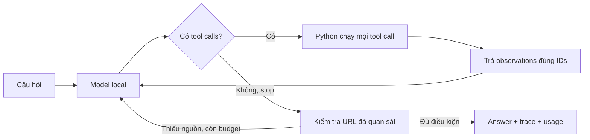

# Báo cáo tổng kết bài chính — Status Investigation Agent

Học viên: **Phan Trọng Hậu** — MSSV **2A202603547**, lớp **L3A**.

Bài chính đã có code, hai bộ eval đầy đủ, phân tích, tests và công cụ demo.
**Chưa xác nhận trình bày trực tiếp hoặc nộp LMS.** Bonus 15 điểm là tùy chọn và
chưa thực hiện bộ eval bonus; không coi điểm eval là điểm bài lab.

## Cách hoạt động



`agent.py` kiểm soát `max_steps`, lỗi arguments/tool/provider và điều kiện dừng;
thêm context cho status chưa xác minh, bỏ qua chỉ dẫn giả trong dữ liệu. Source
gate yêu cầu ít nhất một URL incident đã quan sát, không bảo đảm mọi claim đúng.

## Kết quả hai bộ eval

| Chỉ số | Trước | Sau |
|---|---:|---:|
| Case được chấm | 22/22 | 22/22 |
| Điểm eval | 84.27 | 85.73 |
| H7 — không bịa status khi timeout | 40 | 93 |
| Model calls agent | 43 | 46 |
| Tool calls | 32 | 32 |
| Tổng token agent + judge | 92,234 | 124,513 |

10 case tăng, 8 giữ nguyên, 4 giảm. Điểm hiển thị tăng 1.46; token tăng 35%.
Model và judge đều dùng Ollama `status-agent-local` từ Qwen3 4B, cùng weights,
context 16384, output 2048, temperature 0, max_steps 8, workers 1, snapshot/core.
Không có phí API dịch vụ; chưa đo chi phí điện/phần cứng local.

Cải thiện được quan sát: H7 báo Cloudflare chưa xác minh do timeout; E2 đọc chi tiết
phạm vi; source gate yêu cầu sửa URL ở A6/A7. Hạn chế: H1/H3/H6 vẫn thiếu điều tra,
H2 có regression, A6 có URL nhưng không đọc incident liên quan. Judge chấm sai/thiếu
ở H4/A5/A6. Chỉ một lượt hoàn tất mỗi phiên bản không chứng minh độ ổn định.

## Bộ nộp và bằng chứng

- [agent.py](agent.py): agent loop sau cải tiến, khớp hash bản đã eval.
- [eval_before.json](eval_before.json), [eval_after.json](eval_after.json): 22 case mỗi bộ, điểm tổng khác null.
- [NOTES.md](NOTES.md): đủ 5 mục phân tích dựa trên trace thật.
- [DEMO.md](DEMO.md): kịch bản trình bày và lệnh replay.
- [Tiến độ từng CP](reports/PROGRESS.md), [report CP6](reports/CP6_REPORT.md),
  [checklist bàn giao CP7](reports/CP7_REPORT.md).
- [Kiểm tra bộ nộp](reports/cp7_submission_checks.txt), [tests](reports/cp7_tests.txt):
  59 tests chính pass; 3 tests tương thích bonus pass, không phải điểm bonus.

## Test nhanh

```bash
python3 local/check_submission.py
python3 local/demo.py --case A8 --version after --summary-only
python3 local/demo.py --case H7 --version both
```

Các lệnh trên không gọi model. Chạy câu hỏi mới: xem [hướng dẫn local](local/README.md).

## Bàn giao

Repo: https://github.com/Phan-Trong-Hau/K5-L3A-DAY04-PhanTrongHau-2A202603547-ReactLoopAgent

Nơi nộp: https://aithucchien.vinuni.edu.vn — bài Day 04, tài khoản cá nhân.
PR #1 đã merge; public main đã được kiểm tra có đúng code, hai file eval và notes/report/demo.
Bằng chứng: [xác nhận GitHub](reports/cp7_remote_verification.json). Phần trình bày trực tiếp và xác nhận LMS không được tự đánh dấu đã hoàn tất.
