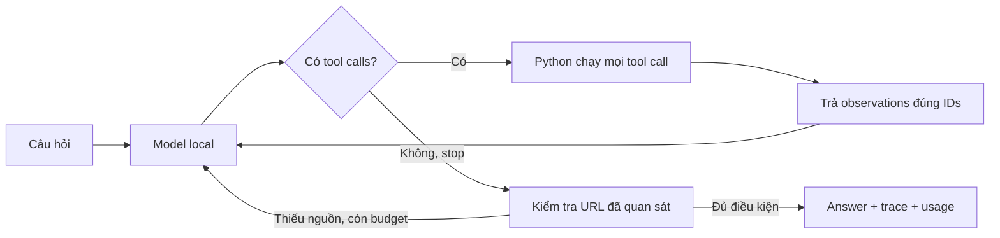

# Báo cáo tổng kết bài chính — Status Investigation Agent

Học viên: **Phan Trọng Hậu** — MSSV **2A202603547**, lớp **L3A**.

Bài chính đã có code, hai bộ eval đầy đủ, phân tích, tests và công cụ demo.
**Chưa xác nhận trình bày trực tiếp hoặc nộp LMS.** Bonus đã chạy đủ 10 case; không coi điểm eval là điểm bài lab.

## Cách hoạt động



`agent.py` giữ luồng core, dispatch vào `bonus/agent.py` cho bộ 5 providers. Core kiểm soát `max_steps`, lỗi arguments/tool/provider và điều kiện dừng;
thêm context cho status chưa xác minh và quy tắc bỏ qua chỉ dẫn giả trong dữ liệu.
Các quy tắc này không bảo đảm model luôn tuân thủ; kết quả và lỗi thực tế được ghi ở report chi tiết. Source
gate yêu cầu ít nhất một URL incident đã quan sát, không bảo đảm mọi claim đúng.

## Kết quả hai bộ eval

| Chỉ số | Trước | Sau |
|---|---:|---:|
| Case được chấm | 22/22 | 22/22 |
| Điểm eval | 84.27 | 85.73 |
| H7 — không bịa status khi timeout | 40 | 93 |
| Model calls agent | 43 | 46 |
| Tool calls | 32 | 32 |
| Tổng token agent + judge | 92,234 | 124,513 |

10 case tăng, 8 giữ nguyên, 4 giảm. Điểm hiển thị tăng 1.46; token tăng 35%.
Model và judge đều dùng Ollama `status-agent-local` từ Qwen3 4B, cùng weights,
context 16384, output 2048, temperature 0, max_steps 8, workers 1, snapshot/core.
Không có phí API dịch vụ; chưa đo chi phí điện/phần cứng local.

Cải thiện được quan sát: H7 báo Cloudflare chưa xác minh do timeout; E2 đọc chi tiết
phạm vi; source gate yêu cầu sửa URL ở A6/A7. Hạn chế: H1/H3/H6 vẫn thiếu điều tra,
H2 có regression, A6 có URL nhưng không đọc incident liên quan. Judge chấm sai/thiếu
ở H4/A5/A6. Chỉ một lượt hoàn tất mỗi phiên bản không chứng minh độ ổn định.

## Bộ nộp và bằng chứng

- [agent.py](agent.py): core + dispatcher bonus; core bỏ dispatcher khớp hash CP6,
  lưu nguyên bản tại [reference](reports/reference/agent_cp6.py).
- [eval_before.json](eval_before.json), [eval_after.json](eval_after.json): 22 case mỗi bộ, điểm tổng khác null.
- [NOTES.md](NOTES.md): đủ 5 mục phân tích dựa trên trace thật.
- [DEMO.md](DEMO.md): kịch bản trình bày và lệnh replay.
- [Tiến độ từng CP](reports/PROGRESS.md), [report CP6](reports/CP6_REPORT.md),
  [checklist bàn giao CP7](reports/CP7_REPORT.md).
- Kiểm tra hiện tại: **61 tests chính + 22 tests bonus pass**;
  [main tests mới](reports/report_audit_main_tests.txt), [bonus tests mới](reports/report_audit_bonus_tests.txt),
  [kiểm tra bộ nộp](reports/report_audit_submission_checks.txt). Các log `cp7_*` là mốc lịch sử trước bonus.

## Test nhanh

```bash
python3 local/check_submission.py --bonus
python3 local/demo.py --case A8 --version after --summary-only
python3 local/demo.py --case H7 --version both
```

Các lệnh trên không gọi model. Chạy câu hỏi mới: xem [hướng dẫn local](local/README.md).

## Bàn giao

Repo: https://github.com/Phan-Trong-Hau/K5-L3A-DAY04-PhanTrongHau-2A202603547-ReactLoopAgent

Nơi nộp: https://aithucchien.vinuni.edu.vn — bài Day 04, tài khoản cá nhân.
PR #1 (core) và PR #2 (bonus, merge `1da1845`) đã merge vào main.
[Xác nhận GitHub CP7](reports/cp7_remote_verification.json) là bằng chứng tại mốc core;
[đối chiếu báo cáo mới](reports/REPORT_AUDIT.md) bao gồm cả bonus. Phần trình bày trực tiếp và xác nhận LMS không được tự đánh dấu đã hoàn tất.


## Bonus đã hoàn thiện

- **10/10 case scored**, không unscored hoặc mechanical violations.
- Điểm eval **88.2/100**, quy đổi tham khảo **13.23/15** bằng grader gốc.
- Snapshot 5 providers; cùng model local, max_steps=16. 31 model calls, 32 tool
  executions; 118,949 token agent + judge cho lượt cuối.
- Có bounded retry/Retry-After, scheduled recovery, lookup theo yêu cầu, pagination,
  lọc context không liên quan và guard ngoài registry. Không sửa grading/fixtures.
- Vẫn có lỗi nội dung model và judge; đặc biệt B10 sai target URL DigitalOcean,
  diễn giải status Cloudflare và thiếu timestamp. Không cộng điểm eval core với
  bonus để tự suy điểm lab.

Kết quả: [eval_bonus.json](eval_bonus.json). Report: [BONUS_REPORT.md](reports/BONUS_REPORT.md).
Hướng dẫn: [bonus/README.md](bonus/README.md). Bộ nộp giờ có cả bài chính và bonus;
việc nộp LMS/trình bày trực tiếp vẫn chưa được xác nhận.

## Đối chiếu với đề

[Bảng yêu cầu → bằng chứng](reports/REPORT_AUDIT.md) ghi rõ phần báo cáo đã đủ,
lỗi model còn tồn tại và các việc chưa xác nhận: demo trực tiếp, LMS và hạn nộp.
